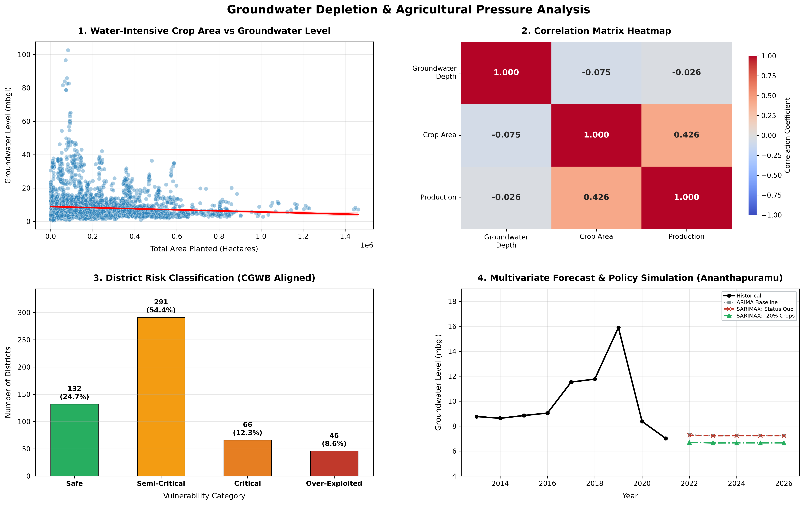

# Groundwater Depletion and Sustainable Agricultural Planning

[](https://www.python.org/)
[](https://opensource.org/licenses/MIT)
[](https://www.statsmodels.org/)
[]()

> **Academic CapStone Project (B.Tech)**  
> **Department of Computer Science and Business Systems (CSBS)**  
> **K. J. Somaiya College of Engineering | Somaiya Vidyavihar University, Mumbai**  
> **Academic Year:** 2026–2027  
> **Project Guide:** Prof. Umang Patel  
> **Team Members:** Varad Bele, Mrunmai Bhagat, Prayaag Bhanushali  

---

## 📌 Project Overview

Groundwater serves as the backbone of India's agricultural economy, supplying more than 60% of irrigation requirements and supporting national food security. However, indiscriminate groundwater extraction—driven by extensive cultivation of water-intensive cash crops such as paddy rice, sugarcane, cotton, and wheat—has triggered alarming aquifer depletion rates across multiple hydrogeological basins.

This project delivers an end-to-end, reproducible data-analytics and time-series forecasting pipeline that:
1. **Harmonizes & Integrates Multimodal Data:** Merges over **550,000 groundwater monitoring observations** (CGWB / India-WRIS) with **345,000 district-level crop records** (Ministry of Agriculture & Farmers Welfare) across **533 districts** over the decadal period 2013–2021/2023.
2. **Evaluates Macro-Scale Linear Relationships:** Computes Pearson correlation and p-values between water-intensive crop area, production, and water table depth ($r = -0.0746, p = 2.74 \times 10^{-7}$).
3. **Implements a CGWB-Aligned District Risk-Scoring Engine:** Classifies 535 Indian districts into four vulnerability categories (*Safe*, *Semi-Critical*, *Critical*, and *Over-Exploited*) by computing 3-year moving average depths and decadal linear depletion slopes ($\text{m/year}$).
4. **Performs Multivariate SARIMAX Scenario Simulation:** Models aquifer dynamics in chronically stressed districts (e.g., Ananthapuramu, Andhra Pradesh) by incorporating cultivated crop acreage as an exogenous variable ($\mathbf{X}$), comparing baseline univariate ARIMA against policy scenarios (Status Quo vs. 20% Crop Shift) to estimate aquifer recharge benefits.
5. **Generates an Publication-Quality Dashboard:** Automates the rendering of a unified, 4-panel visual dashboard at 300 DPI for policy makers and evaluators.

---

## 📊 Evaluation Dashboard



*Figure 1: Four-panel evaluation dashboard generated by `capstone1.py` showing (1) Scatter plot of water-intensive crop area vs. groundwater level with OLS regression; (2) Correlation matrix heatmap of groundwater depth, crop area, and production; (3) National district vulnerability breakdown aligned with CGWB categories; and (4) 5-year multivariate SARIMAX policy simulation for Ananthapuramu.*

---

## 🔬 Key Empirical Findings

### 1. Statistical Correlation Analysis
- **Crop Area vs. Groundwater Depth:** $r = -0.0746$ ($p = 2.7379 \times 10^{-7}$). While statistically significant due to large sample size ($N = 4,735$), the linear relationship at national scale is very weak, demonstrating that national-level groundwater dynamics cannot be attributed to crop area alone without controlling for rainfall variability, canal networks, and aquifer geology.
- **Production vs. Depth:** $r = -0.026$ (negligible linear relationship).
- **Crop Area vs. Production:** $r = +0.426$ (robust positive linear relationship, confirming data integrity).

### 2. CGWB-Aligned District Risk Classification (535 Districts)
| Category | Classification Criteria | District Count | Share (%) |
| :--- | :--- | :---: | :---: |
| 🟢 **Safe** | Recent level $< 5\text{ mbgl}$ and $\text{slope} \le 0\text{ m/yr}$ | **132** | **24.7%** |
| 🟡 **Semi-Critical** | Recent level $\ge 5\text{ mbgl}$ or $\text{slope} > 0\text{ m/yr}$ | **291** | **54.4%** |
| 🟠 **Critical** | Recent level $\ge 10\text{ mbgl}$, or ($\ge 8\text{ mbgl}$ and $\text{slope} > 0.1\text{ m/yr}$) | **66** | **12.3%** |
| 🔴 **Over-Exploited** | Recent level $\ge 20\text{ mbgl}$, or ($\ge 15\text{ mbgl}$ and $\text{slope} > 0.2\text{ m/yr}$) | **46** | **8.6%** |
| **Total** | Evaluated Indian Districts | **535** | **100.0%** |

#### Top 5 Most Stressed Over-Exploited Districts
1. **Gandhinagar (Gujarat):** $94.99\text{ mbgl}$ | Depletion rate: $+2.044\text{ m/yr}$
2. **Jhunjhunu (Rajasthan):** $59.59\text{ mbgl}$ | Depletion rate: $+0.364\text{ m/yr}$
3. **Sikar (Rajasthan):** $45.77\text{ mbgl}$ | Depletion rate: $-0.229\text{ m/yr}$
4. **Mahendragarh (Haryana):** $38.89\text{ mbgl}$ | Depletion rate: $+1.679\text{ m/yr}$
5. **Barnala (Punjab):** $37.98\text{ mbgl}$ | Depletion rate: $+1.716\text{ m/yr}$

### 3. Multivariate Forecasting & Policy Simulation (Ananthapuramu Case Study)
- **Current Observed Groundwater Depth (2021):** $7.02\text{ mbgl}$
- **5-Year Univariate ARIMA(1,1,0) Baseline:** $7.25\text{ mbgl}$
- **5-Year SARIMAX(1,1,0) [Status Quo Crop Acreage]:** $7.23\text{ mbgl}$
- **5-Year SARIMAX(1,1,0) [20% Sustainable Crop Diversification]:** $6.66\text{ mbgl}$
- **Net Aquifer Recharge Benefit:** **$+0.57\text{ metres}$** of water table recovery.

---

## 🏗️ Repository Structure

```
├── capstone1.py                      # Master pipeline: cleaning, merging, correlation, risk index, SARIMAX, dashboard
├── district_risk_classification.csv  # Generated risk classification of 535 districts
├── capstone_evaluation_dashboard.png # High-resolution 300 DPI 4-panel dashboard
├── requirements.txt                  # Python dependencies
├── .gitignore                        # Git exclusion rules (ignores raw CSVs > 25MB)
├── README.md                         # Project documentation and reproduction guide
└── docs/
    └── Groundwater_Depletion_Report.docx # Formatted academic capstone report
```

---

## ⚙️ Installation & Reproducibility Guide

### 1. Clone the Repository
```bash
git clone https://github.com/varad-op/groundwater-crop-depletion-analysis.git
cd groundwater-crop-depletion-analysis
```

### 2. Set Up Virtual Environment & Dependencies
```bash
python -m venv venv
# Windows:
venv\Scripts\activate
# Linux/macOS:
source venv/bin/activate

pip install --upgrade pip
pip install -r requirements.txt
```

### 3. Obtain Dataset Files
Place the following cleaned datasets into the repository root directory:
- `groundwater_cleaned.csv` (Source: [India-WRIS / CGWB](https://indiawris.gov.in))
- `crop_production_cleaned.csv` (Source: [APS Portal, Ministry of Agriculture](https://aps.dac.gov.in) & [data.gov.in](https://data.gov.in))

### 4. Execute the Analytical Pipeline
```bash
python capstone1.py
```

The script will automatically:
- Load, parse, clean, and merge district-level datasets.
- Print statistical correlation matrices and p-values to stdout.
- Compute the CGWB-aligned risk metrics and export `district_risk_classification.csv`.
- Train ARIMA and SARIMAX models for Ananthapuramu and simulate policy interventions.
- Render and save `capstone_evaluation_dashboard.png` (300 DPI).

---

## 📚 Data Sources & References

1. **Central Ground Water Board (CGWB):** Ministry of Jal Shakti, Government of India. *National Compilation on Dynamic Ground Water Resources of India*, [India-WRIS](https://indiawris.gov.in).
2. **Directorate of Economics & Statistics (DES):** Department of Agriculture & Farmers Welfare, Ministry of Agriculture & Farmers Welfare, Government of India. *Agricultural Production Statistics (APS)*, [APS DAC](https://aps.dac.gov.in).
3. **Rodell, M., Velicogna, I., & Famiglietti, J. S. (2009):** Satellite-based estimates of groundwater depletion in India. *Nature*, 460(7258), 999-1002.
4. **Asoka, A., Gleeson, T., Wada, Y., & Mishra, V. (2017):** Relative contribution of monsoon precipitation and pumping to changes in groundwater storage in India. *Nature Geoscience*, 10(2), 109-117.
5. **Box, G. E. P., Jenkins, G. M., Reinsel, G. C., & Ljung, G. M. (2015):** *Time Series Analysis: Forecasting and Control* (5th ed.). John Wiley & Sons.

---

## 👥 Authors & Acknowledgments

- **Varad Bele** 
- **Mrunmai Bhagat** 
- **Prayaag Bhanushali** 

*Under the guidance of:* **Prof. Umang Patel**, Department of Computer Science and Business Systems (CSBS), K. J. Somaiya College of Engineering, Somaiya Vidyavihar University.

---

## 📄 License
This project is licensed under the MIT License - see the [LICENSE](LICENSE) file for details.
